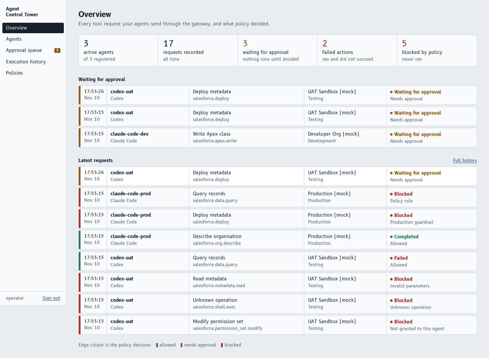
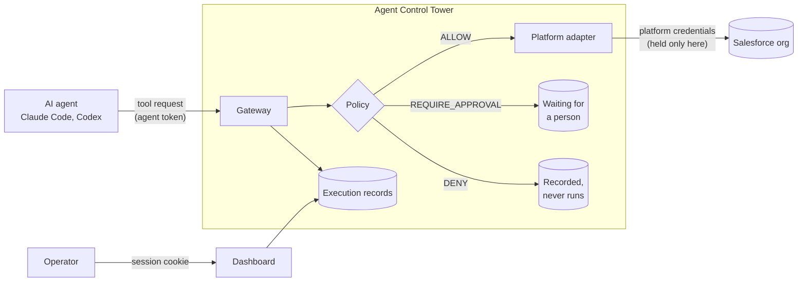

# Agent Control Tower

A gateway that sits between AI coding agents and enterprise systems. Agents ask
it to do things; it decides by policy, records every request, and only then
acts on their behalf with credentials the agents never see.

Salesforce is the first supported platform. The core is platform-agnostic.

> **Status: Phase 1 of 4.** The policy gateway, audit records, mock Salesforce
> adapter, management API and dashboard work and are tested. Human approval
> decisions, the MCP server and the real Salesforce adapter are not built yet.
> See [What works today](#what-works-today).



## The problem

Three things happened to me while using AI coding agents on Salesforce projects:

1. **An agent deployed to a test org without being asked.** I found out when I
   had to explain changes I did not know had been made.
2. **An agent said it had run the tests. It had not.**
3. **An agent kept proposing a workaround the platform no longer needed.**

Instructions in `AGENTS.md` or `CLAUDE.md` help, but an instruction is a request,
not a control. This project enforces the boundary in code:

| Instead of                                   | Agent Control Tower                                              |
| -------------------------------------------- | ---------------------------------------------------------------- |
| Telling the agent not to deploy              | The agent has no credentials; only the gateway can deploy        |
| Trusting "I ran the tests"                   | Test results are recorded by the gateway from the system itself  |
| Hoping the agent asks first                  | Sensitive operations stop and wait for a person                  |

## How it works



Every request produces exactly one execution record with the agent, the target
environment, the validated parameters, a SHA-256 fingerprint of the action, the
policy decision and its reason, timestamps, and the result or error returned by
the target system.

## Run it locally (no Salesforce account needed)

Requires Docker.

```bash
cp .env.example .env
make up          # PostgreSQL, API on :8000, dashboard on :3000
make seed        # prints the operator password and three agent tokens, once
make simulate    # sends 16 demo requests through the gateway
```

Open <http://localhost:3000> and sign in as `operator`.

Then try it as an agent. This asks to deploy to the (mock) UAT sandbox:

```bash
curl -s http://localhost:8000/api/v1/gateway/tool-requests \
  -H "Authorization: Bearer <codex-uat token from make seed>" \
  -H "Content-Type: application/json" \
  -d '{"operation": "salesforce.deploy",
       "parameters": {"components": [{"metadata_type": "ApexClass",
                                      "full_name": "Billing",
                                      "body": "public class Billing {}"}]}}'
```

The answer is `202` with `"status": "PENDING_APPROVAL"`. Nothing was deployed,
and the request is now in the dashboard's approval queue. Send the same request
with the `claude-code-prod` token and it is `DENIED` by the production guardrail.

Running without Docker is described in [docs/development-guide.md](docs/development-guide.md).

## What works today

| Area                                                              | State                |
| ----------------------------------------------------------------- | -------------------- |
| Policy decision (allow, require approval, deny, default deny)     | Working, tested      |
| Production guardrail (only reads can ever reach production)       | Working, tested      |
| Strict per-operation parameter schemas                            | Working, tested      |
| Execution records with action fingerprint and correlation ID      | Working, tested      |
| Secret detection and redaction (payloads, results, logs)          | Working, tested      |
| Mock Salesforce adapter (8 operations, inspectable state)         | Working, tested      |
| Operator sign-in, agent tokens, strict separation of the two      | Working, tested      |
| Dashboard: overview, agents, approval queue, history, policies    | Working, read-only   |
| Approve / reject with hash-bound, expiring, single-use approvals  | **Phase 2**          |
| Policy editing, append-only audit event log                       | **Phase 2**          |
| MCP server, real Salesforce adapter                               | **Phase 3**          |
| Evaluation lab, metrics, OpenTelemetry                            | **Phase 4**          |

Until Phase 2, a request that needs approval stays `PENDING_APPROVAL`. It is
recorded and visible, and there is no code path that can execute it.

## Verification

Results from the last run before this commit are in
[docs/verification.md](docs/verification.md), including what was *not* verified.

```bash
make test        # ruff, mypy --strict, pytest (needs PostgreSQL), eslint, tsc, vitest, next build
```

## What this does not do

The gateway can only control actions that go through it. If an agent also has a
shell with an authenticated Salesforce CLI, it can deploy without asking, and
nothing here will stop it or know about it. Removing that access is a
deployment requirement, not something this software can do for you. See
[docs/security-model.md](docs/security-model.md).

## Documentation

- [Architecture](docs/architecture.md): components, request flow, data model
- [Security model](docs/security-model.md): trust boundaries, controls, limitations
- [API](docs/api.md): gateway and management endpoints
- [Evaluation methodology](docs/evaluation-methodology.md): scenarios and metrics
- [Development guide](docs/development-guide.md): setup, tests, adding an operation
- [Decisions](docs/decisions.md): trade-offs made so far, and why
- [AGENTS.md](AGENTS.md): rules for AI agents working on this repository

## Licence

MIT
