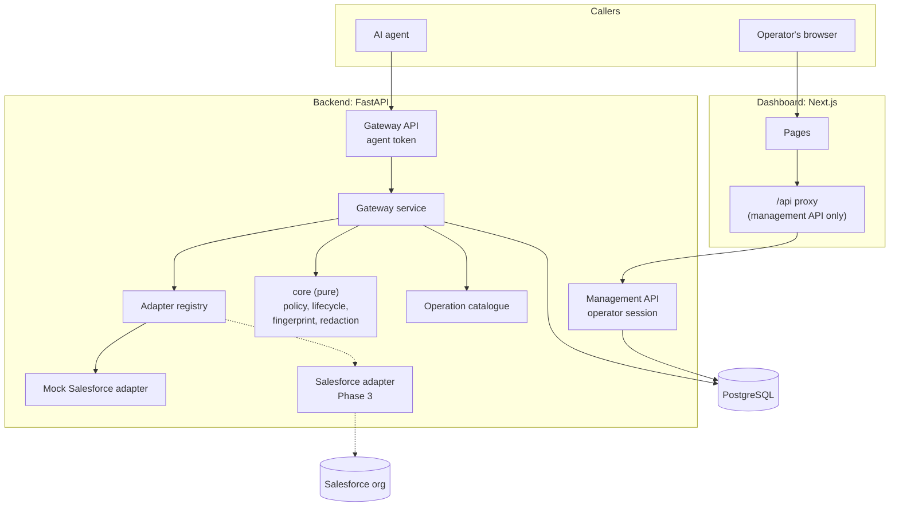
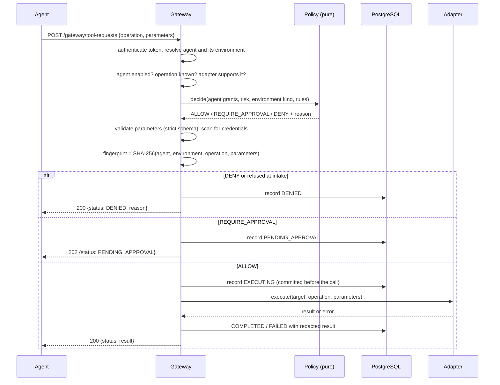
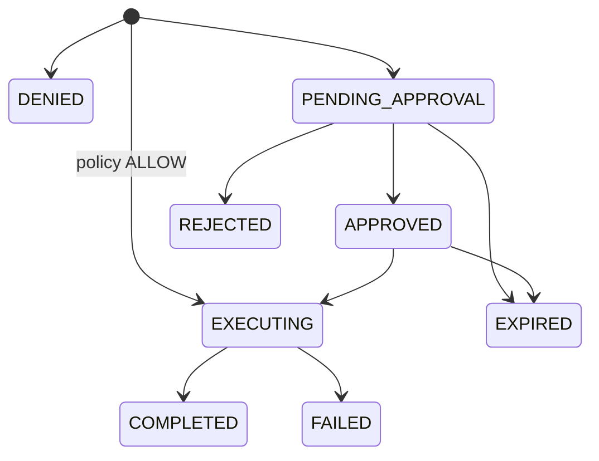

# Architecture

## Components



| Package                    | Responsibility                                                         | May import                |
| -------------------------- | ---------------------------------------------------------------------- | ------------------------- |
| `control_tower.core`       | Policy decision, state machine, fingerprint, redaction, port interfaces | standard library, Pydantic |
| `control_tower.platforms`  | Operation schemas and adapters, per platform                            | `core`                    |
| `control_tower.gateway`    | The request pipeline                                                    | `core`, `platforms`, `persistence` |
| `control_tower.persistence`| SQLAlchemy models, read queries                                         | `core`                    |
| `control_tower.api`        | HTTP, authentication, serialisation                                     | everything above          |

`core` has no I/O. The policy function takes plain values and returns a
decision, so its full decision table (192 combinations) is tested exhaustively
in milliseconds.

## Request flow



Three properties of this flow matter:

- **The agent does not choose its target.** An agent identity is bound to one
  environment. To work in two orgs you register two agents.
- **Policy runs before parameter validation.** An agent that is not allowed to
  call an operation learns nothing about its schema.
- **The `EXECUTING` record is committed before the adapter is called.** A crash
  mid-operation leaves evidence that it started.

## Execution states



`DENIED` is outside the approval lifecycle on purpose: it has no outgoing
transition, so a denied request can never become an executed one. The
approval and rejection endpoints remain to be built. Background maintenance
expires waiting or approved requests whose stored deadline has elapsed.

The API lifespan starts a maintenance thread with separate sessions. Each tick
processes bounded batches with row locks and SKIP LOCKED. Stale EXECUTING rows
receive a reconciliation timestamp and an audit event. Their outcome stays
unknown; the worker never calls an adapter or changes them to FAILED.
A returned adapter result clears the marker in the finishing transaction.

## Policy evaluation

First match wins:

1. Agent disabled: **DENY**
2. Operation not granted to this agent: **DENY**
3. Operation is not a read and the environment is production: **DENY** (guardrail, not configurable)
4. A rule exists for (operation, environment kind): that rule's effect
5. No rule: **DENY**

Default policies created by `act seed`:

| Operation                          | Risk    | Development      | Testing          | Production |
| ---------------------------------- | ------- | ---------------- | ---------------- | ---------- |
| `salesforce.org.describe`          | READ    | ALLOW            | ALLOW            | ALLOW      |
| `salesforce.metadata.list`         | READ    | ALLOW            | ALLOW            | ALLOW      |
| `salesforce.metadata.read`         | READ    | ALLOW            | ALLOW            | ALLOW      |
| `salesforce.data.query`            | READ    | ALLOW            | ALLOW            | DENY       |
| `salesforce.tests.run`             | EXECUTE | ALLOW            | ALLOW            | DENY       |
| `salesforce.apex.write`            | WRITE   | REQUIRE_APPROVAL | REQUIRE_APPROVAL | DENY       |
| `salesforce.permission_set.modify` | WRITE   | REQUIRE_APPROVAL | REQUIRE_APPROVAL | DENY       |
| `salesforce.deploy`                | DEPLOY  | REQUIRE_APPROVAL | REQUIRE_APPROVAL | DENY       |

## Data model

| Table               | Purpose                                                                 |
| ------------------- | ----------------------------------------------------------------------- |
| `environments`      | A target system instance: platform, kind, which adapter serves it        |
| `agents`            | Agent identity: provider, bound environment, granted operations, token hash |
| `policy_rules`      | Effect per (operation, environment kind)                                 |
| `executions`        | One row per tool request: decision, parameters, fingerprint, result      |
| `operators`         | People who can sign in to the dashboard                                  |
| `operator_sessions` | Server-side sessions (token hash, expiry, revocation)                    |
| `audit_events`      | Append-only events: actor, action, time, correlation ID and redacted details |

Operations are defined in code, not in a table: each one needs a schema and an
adapter implementation, and both should go through code review.

Authentication, agent-management, seed and approval-request events are added
in the transaction that changes their state. PostgreSQL triggers reject updates,
deletes and truncation of audit events. Actor and execution IDs are retained as
historical identifiers, without cascading foreign keys. Existing records are
not backfilled with invented audit history.

## Platform independence

Nothing in `core`, `gateway`, `persistence` or `api` mentions Salesforce. A new
platform is a new package under `platforms/` that registers `OperationSpec`s and
a `PlatformAdapter`:

```python
class PlatformAdapter(Protocol):
    adapter_key: str
    platform: str
    def supports(self, operation_key: str) -> bool: ...
    def execute(self, target: TargetEnvironment, operation_key: str,
                params: OperationParams) -> dict[str, Any]: ...
```

## Planned (not built)

- **Phase 2:** approval decisions bound to the action fingerprint, with expiry
  and single use; policy editing in the dashboard; audit events for approval decisions.
- **Phase 3:** MCP server exposing the catalogue as tools and calling the
  gateway API; Salesforce adapter (read-only first).
- **Phase 4:** evaluation lab, metrics, OpenTelemetry.
