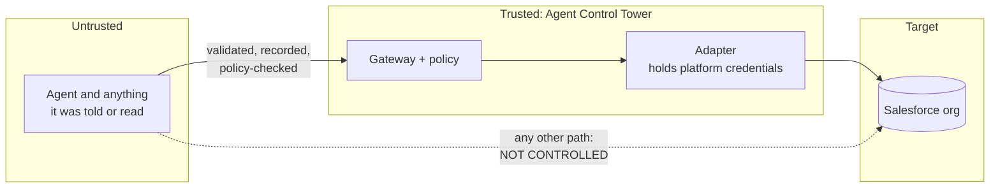

# Security model

## What is being protected

The integrity of enterprise environments (Salesforce orgs) that AI agents work
against, and the truthfulness of the record of what those agents did.

## Actors and credentials

| Actor            | Authenticates with                     | Can                                              | Cannot                                             |
| ---------------- | -------------------------------------- | ------------------------------------------------ | -------------------------------------------------- |
| Agent            | Bearer token, one per agent            | Submit tool requests; read its own requests      | Use the management API; choose its target; see platform credentials |
| Operator         | Password, then an HttpOnly session cookie | Read everything; register and disable agents  | Submit tool requests as an agent                   |
| Platform adapter | Platform credentials (Phase 3)         | Act on the target system when the gateway says so | Decide authorisation                               |

The two credential types are not interchangeable in either direction. This is
tested for every endpoint, and a test fails if a new endpoint is added without
being placed in that matrix.

## Trust boundaries

**The gateway controls only what goes through it.** This is the most important
limitation of the project. If the machine an agent runs on also has an
authenticated `sf` CLI, a stored session, or a connected MCP server with its own
Salesforce access, the agent can act on the org directly. Agent Control Tower
will not prevent that and will not know it happened.

For the controls here to mean anything, the deployment must ensure:

1. The agent's environment holds no Salesforce credentials of any kind.
2. The integration user the adapter uses is the only identity with deploy rights
   on the target org that the agent's work could reach.
3. The agent has the gateway's tools and nothing else that reaches the org.

These are operational requirements. The software cannot verify them.

## Controls in place

| Control | Where | Verified by |
| --- | --- | --- |
| Default deny when no rule matches | `core/policy.py` | exhaustive decision-table test |
| Production guardrail: only reads, regardless of rules | `core/policy.py` | unit and integration tests; the mock org is inspected to confirm nothing changed |
| Per-agent operation grants | `core/policy.py` | permission-escalation test |
| Agent bound to one environment; cannot name a target | `gateway/service.py`, request schema | strict-envelope test |
| Strict parameter schemas: no unknown fields, no coercion, constrained identifiers | `platforms/salesforce/operations.py` | schema tests, including injection-shaped inputs |
| No shell, no arbitrary CLI, no free-form SOQL | operation catalogue | there is no such operation; an unknown operation is denied and recorded |
| Requests carrying credential-shaped values are refused | `gateway/service.py` | integration tests |
| Results, errors and logs are redacted | `core/redaction.py`, `logging.py` | unit and integration tests |
| Every request leaves exactly one record | `gateway/service.py` | invariant test |
| Record is durable before the side effect | `gateway/service.py` | code review; see limitations |
| Adapter crashes are contained and do not leak internals | `gateway/service.py` | integration test |
| Tokens stored only as SHA-256; shown once | `security/tokens.py` | tests |
| Passwords hashed with Argon2id; uniform failure response | `security/passwords.py` | tests |
| Sessions: HttpOnly, SameSite=Strict, server-side revocation and expiry | `api/routes/auth.py`, `api/deps.py` | tests |
| Origin check on state-changing cookie requests | `api/deps.py` | tests |
| Login throttling | `security/throttle.py` | tests |
| Request size limit (1 MiB) | `api/middleware.py` | test |
| Dashboard cannot be framed; gateway API not reachable through the dashboard origin | `frontend/next.config.ts`, proxy route | checked over HTTP (see verification.md) |
| Mock and real adapters isolated | `platforms/registry.py` | an environment naming an unregistered adapter is denied |

Eleven of these checks were also verified by mutation: the check was removed
from the code and the suite was confirmed to fail. They are the production
guardrail, default deny, the grant check, the approval pause, the disabled-agent
check, the secret scan, result redaction, session revocation, session expiry,
the origin check and agent isolation on the polling endpoint.

## Why a payload with a secret is refused rather than redacted

The stored parameters are what gets fingerprinted and, from Phase 2, what an
operator approves and what is executed. If the gateway silently rewrote a
payload, those three things would no longer be the same object. So a valid
payload is stored byte-for-byte as validated, and a payload containing something
that looks like a credential is refused outright. Only refused payloads are
stored in redacted form.

## Known limitations

- **Approval decisions are available through the operator API.** Agent tokens
  cannot approve, reject or dispatch approvals. Every decision binds the
  execution, hash, agent and environment. Dispatch consumes the immutable
  approval under a row lock, rechecks current eligibility and uses only stored
  parameters. Dashboard controls require review of the displayed stored action
  before a decision can be submitted.
- **Policy editing is available through the operator API.** Every write to a
  non-read production cell is rejected. Policy changes and their previous
  values are audited in the same transaction. Dashboard cells use the server's
  guardrail reason to hide editing controls for fixed production policies.
  Audit events also cover authentication, agent management, seeded policies,
  pending approval requests, approvals, rejections, consumption and expirations.
- **Audit events are append-only for ordinary SQL writes.** PostgreSQL rejects
  UPDATE, DELETE and TRUNCATE. The application has an insert helper only, and
  inserts events in the state-changing transaction. Credentials are never
  included in authentication events; other details pass through redaction.
- **Secret detection is pattern-based.** It recognises Salesforce session
  tokens, CLI auth URLs, bearer tokens, JWTs, PEM private keys and this
  project's own tokens. It will miss secrets with no recognisable shape.
- **Crash window.** If the process dies before committing the adapter result,
  the record stays EXECUTING. Maintenance flags stale rows as requiring
  reconciliation, with an unknown outcome. It does not retry or invent a
  result. A long-running call can also reach this threshold; a real adapter
  response clears the marker. Operators still need to verify unresolved cases.
- **Login throttling is in memory,** per process. It does not survive a restart
  or span multiple instances.
- **One operator role.** No roles, no multi-factor authentication, no SSO.
- **No TLS in the local stack.** Tokens and the session cookie travel in clear
  text between containers and to `localhost`. Set `ACT_SESSION_COOKIE_SECURE=true`
  behind HTTPS.
- **No Content-Security-Policy for scripts** on the dashboard, only
  `frame-ancestors`.
- **Agents are not rate limited.**
- **Agent tokens do not expire** and cannot yet be rotated; disable the agent
  and register a new one.
- **The database administrator is trusted.** An administrator who can drop or
  disable triggers can bypass audit protections. Other tables remain mutable.
  Tamper-evidence (hash chaining) is a possible later addition.
- **Not a production deployment.** The Compose file is for local development.

## Reporting a problem

Open a GitHub issue. Do not include real credentials or customer data.
